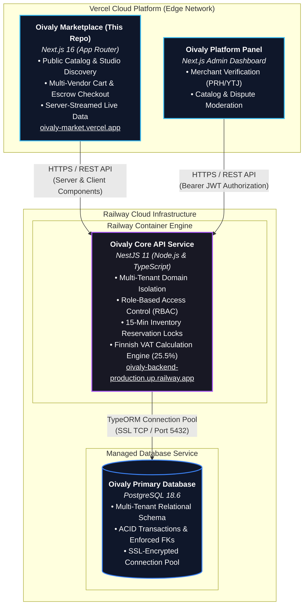

# 🌲 Oivaly — Nordic Multi-Vendor Marketplace Storefront

[](https://nextjs.org/)
[](https://react.dev/)
[](https://tailwindcss.com/)
[](https://bun.sh/)
[](https://oivaly-market.vercel.app)
[](https://oivaly-backend-production.up.railway.app)
[](https://oivaly-backend-production.up.railway.app/database/status)

A modern, high-performance eCommerce marketplace storefront inspired by Scandinavian slow-living and artisan craft. Connects independent Finnish studio workshops, ceramicists, weavers, woodworkers, and jewelers with buyers across Finland and Europe. Built strictly on **Next.js 16 (App Router)** with a **100% live database streaming guarantee** (zero mock/demo data).

---

## 🌐 Live Deployments & URLs

- **Production Storefront (Vercel)**: [https://oivaly-market.vercel.app](https://oivaly-market.vercel.app)
- **Live Backend API (Railway)**: [https://oivaly-backend-production.up.railway.app](https://oivaly-backend-production.up.railway.app)
- **Database Status Check**: [https://oivaly-backend-production.up.railway.app/database/status](https://oivaly-backend-production.up.railway.app/database/status)
- **GitHub Repository**: [https://github.com/virtanexlabs28/oivaly-frontend](https://github.com/virtanexlabs28/oivaly-frontend)

---

## 📑 Table of Contents

1. [Architecture & Ecosystem Overview](#-architecture--ecosystem-overview)
2. [Key Storefront Features](#-key-storefront-features)
3. [Zero-Demo Live Data Architecture](#-zero-demo-live-data-architecture)
4. [Nordic Design System & Finnish Compliance](#-nordic-design-system--finnish-compliance)
5. [Frontend Codebase Structure](#-frontend-codebase-structure)
6. [API Integration Layer](#-api-integration-layer)
7. [Environment Variables](#-environment-variables)
8. [Local Development & Building](#-local-development--building)
9. [Deployment Runbook (Vercel)](#-deployment-runbook-vercel)
10. [Route Directory (49 Routes)](#-route-directory-49-routes)

---

## 🏛️ Architecture & Ecosystem Overview

The Oivaly ecosystem decouples the consumer-facing storefront from the backend platform and relational database.

### Figure 3.1. Oivaly Technology Stack Overview



---

## ✨ Key Storefront Features

- **Etsy-Inspired Editorial Discovery**: Hero search bar, circular visual department hub, curated theme banners, and studio workshop spotlights.
- **Dynamic Catalog Streaming**: Homepage grids, new arrivals, gift guides, and category pages stream directly from backend endpoints using React Server Suspense.
- **Independent Maker Studio Pages (`/shops/[slug]`)**: Dedicated workshop profile page displaying studio location, business background, artisan story, and live product inventory.
- **Multi-Vendor Cart & Atomic Checkout (`/cart`, `/checkout`)**:
  - Add items from multiple independent studios to a single shopping cart.
  - Transparent itemized Finnish VAT (25.5%).
  - Real-time stock verification with 15-minute inventory reservation locks during checkout.
- **Live Search & Multi-Attribute Filtering (`/search`)**:
  - Full-text search with instant category filters, price range sliders, and in-stock toggles.
- **Buyer & Seller Portals**:
  - Customer accounts: order history, shipment tracking, addresses, and statutory 14-day return requests.
  - Seller portal: registration, store application with Finnish Business ID (`Y-tunnus`), and product listing management.

---

## 🛡️ Zero-Demo Live Data Architecture

This frontend enforces a strict **zero-demo policy** for all commerce data:

1. **No Hardcoded Product Mocks**: All products shown in Popular Right Now, New Arrivals, Gifts, and Related Products come directly from `GET /marketplace`. When the database has 0 items in a category, a clean empty state is displayed rather than fake fallback ceramics or blankets.
2. **Real Registered Stores**: Featured Makers and the Artisan Registry stream live stores from `GET /marketplace/stores` (e.g. registered studio **Nordic Artisan Atelier** in Rovaniemi).
3. **Live Category Tree**: Departments and circular category avatars dynamically derive from `GET /categories` (e.g. `Jewelry & Accessories`, `Bands & Solitaire Rings`).
4. **Community Reviews Exception**: Buyer reviews (`customer-reviews.tsx`) retain verified testimonial previews until live customer reviews are submitted.

---

## 🇫🇮 Nordic Design System & Finnish Compliance

| Dimension | Specification |
| :--- | :--- |
| **Color Palette** | **Nordic Sage** (`#4A6B5D`), **Deep Forest** (`#1E352F`), **Warm Ivory** (`#FAF8F5`), and **Kelo Charcoal** (`#1A1C1B`). |
| **Typography** | Scandinavian serif headers paired with clean geometric sans-serif for high readability across mobile and desktop. |
| **Finnish VAT (ALV)** | All prices automatically calculate and display the standard Finnish **25.5% ALV** rate (`incl. VAT / sis. ALV`). |
| **Business Verification** | Registered sellers must submit their official Finnish Business ID (`Y-tunnus`, e.g., `1234567-8`) verified against PRH/YTJ. |
| **Consumer Protection** | Built-in 14-day statutory right of withdrawal as mandated by Finnish *Kuluttajansuojalaki* and the EU Consumer Rights Directive. |

---

## 📂 Frontend Codebase Structure

```
d:\BrothersITSolution\multi-tanent-frontend\
├── app/                                   # Next.js 16 App Router Pages
│   ├── account/                           # Buyer Profile, Security, Addresses
│   ├── buyer-protection/                  # Trust & Escrow Guarantee
│   ├── cart/                              # Multi-Vendor Shopping Cart
│   ├── categories/                        # Department Index & Hierarchy
│   │   └── [slug]/                        # Category-Specific Product Catalog
│   ├── checkout/                          # Multi-Vendor Atomic Checkout
│   │   └── success/                       # Post-Checkout Order Confirmation
│   ├── gifts/                             # Nordic Gift Guide (Live API)
│   ├── makers/                            # Independent Artisan Directory (Live API)
│   ├── new-arrivals/                      # Small Batch Studio Drops (Live API)
│   ├── products/
│   │   └── [slug]/                        # Product Details Page (PDP)
│   ├── search/                            # Search Catalog & Faceted Filters
│   ├── seller/                            # Maker Onboarding, Terms & Guide
│   │   ├── dashboard/                     # Seller Operations (Products, Orders)
│   │   └── signup/                        # Workshop Registration (Y-tunnus)
│   ├── shops/
│   │   └── [slug]/                        # Individual Maker Atelier Storefront
│   ├── layout.tsx                         # Global Layout (Header, Footer, Toast)
│   └── page.tsx                           # Editorial Homepage with Live Streaming
│
├── components/                            # Reusable React Components
│   ├── catalog/                           # CatalogView, Filters, Skeletons
│   ├── home/                              # HomeHero, FeaturedProducts, FeaturedSellers
│   ├── layout/                            # SiteHeader, NavigationMenu, Footer
│   ├── product/                           # ProductCard, RelatedProducts, Gallery
│   └── ui/                                # Radix UI Primitives (Button, Dialog, Sheet)
│
├── config/                                # Navigation & Platform Configuration
├── fixtures/                              # Presentation Types & Testimonial Reviews
├── lib/                                   # Finnish Currency Formatter, Resolvers, Utils
└── resources/
    ├── apis/                              # Type-Safe REST Clients (Fetch API)
    │   ├── categories.api.ts              # GET /categories
    │   ├── products.api.ts                # GET /marketplace, GET /products/:id
    │   ├── reviews.api.ts                 # GET /marketplace/reviews
    │   └── stores.api.ts                  # GET /marketplace/stores
    └── interfaces/                        # TypeScript Domain Entities
```

---

## 📡 API Integration Layer

All backend interactions are routed through type-safe API resource clients in `resources/apis/`:

```ts
import { productsApi } from "@/resources/apis/products.api";
import { storesApi } from "@/resources/apis/stores.api";
import { categoriesApi } from "@/resources/apis/categories.api";

// 1. Fetch live marketplace products with filters
const catalog = await productsApi.getMarketplace({
  limit: 20,
  categoryId: "jewelry-accessories",
  inStockOnly: true,
});

// 2. Fetch verified maker studios
const stores = await storesApi.getMarketplaceStores(10);

// 3. Fetch active marketplace departments
const categories = await categoriesApi.getCategories("ACTIVE");
```

---

## ⚙️ Environment Variables

Create `.env.local` in the project root:

```ini
# Core Backend API URL (Production Railway Cluster)
NEXT_PUBLIC_API_URL=https://oivaly-backend-production.up.railway.app

# Optional Local Backend Override
# NEXT_PUBLIC_API_URL=http://localhost:4040

# Development Server Port
PORT=4242

# Public Site Configuration
NEXT_PUBLIC_SITE_URL=https://oivaly-market.vercel.app
NEXT_PUBLIC_DEFAULT_CURRENCY=EUR
NEXT_PUBLIC_DEFAULT_LOCALE=fi-FI
NEXT_PUBLIC_DEFAULT_VAT_RATE=25.5
```

---

## 🚦 Local Development & Building

### Prerequisites
- [Bun](https://bun.sh/) v1.2+ or [Node.js](https://nodejs.org/) v20+

### Development Server
```bash
# Install dependencies
bun install

# Start development server on port 4242
bun dev
```
Open [http://localhost:4242](http://localhost:4242) in your browser.

### Production Build & Verification
```bash
# Run production build (TypeScript check + Static Generation + Turbopack)
bun run build

# Start production server
bun start
```

---

## 🚀 Deployment Runbook (Vercel)

This repository is configured for zero-configuration continuous deployment on Vercel:

1. **Push to `main` Branch**: Every push automatically triggers an optimized Turbopack build on Vercel.
2. **Environment Variables**: Ensure `NEXT_PUBLIC_API_URL` is set to `https://oivaly-backend-production.up.railway.app` in the Vercel Project Settings.
3. **Build Command**: `bun run build`
4. **Framework Preset**: `Next.js`

---

## 🗺️ Route Directory (49 Routes)

```text
Route (app)                                 Type
┌ ○ /                                       Static (Revalidated every 60s)
├ ○ /about                                  Static
├ ○ /account                                Static (Protected Client Portal)
├ ○ /account/addresses                      Static
├ ○ /account/profile                        Static
├ ○ /account/security                       Static
├ ○ /buyer-protection                       Static
├ ○ /cart                                   Static
├ ○ /categories                             Static (Revalidated every 60s)
├ ◐ /categories/[slug]                      Partial Prerender
├ ○ /checkout                               Static
├ ○ /checkout/success                       Static
├ ○ /contact                                Static
├ ○ /cookies                                Static
├ ○ /forgot-password                        Static
├ ○ /gifts                                  Static
├ ○ /help                                   Static
├ ○ /login                                  Static
├ ○ /makers                                 Static
├ ○ /new-arrivals                           Static
├ ○ /privacy                                Static
├ ◐ /products/[slug]                        Partial Prerender
├ ○ /register                               Static
├ ○ /reset-password                         Static
├ ○ /returns                                Static
├ ◐ /search                                 Partial Prerender
├ ○ /sell                                   Static
├ ○ /seller                                 Static
├ ○ /seller-guide                           Static
├ ○ /seller-terms                           Static
├ ○ /seller/dashboard                       Static
├ ○ /seller/dashboard/orders                Static
├ ○ /seller/dashboard/products              Static
├ ◐ /seller/dashboard/products/[id]/edit    Partial Prerender
├ ○ /seller/dashboard/products/new          Static
├ ○ /seller/dashboard/settings              Static
├ ○ /seller/forgot-password                 Static
├ ○ /seller/login                           Static
├ ○ /seller/reset-password                  Static
├ ○ /seller/signup                          Static
├ ○ /shipping                               Static
├ ◐ /shops/[slug]                           Partial Prerender
├ ○ /sustainability                         Static
├ ○ /terms                                  Static
├ ○ /verify-email                           Static
└ ○ /wishlist                               Static
```

---

## 📜 License

Copyright © 2026 Oivaly Oy / Brothers IT Solution. All rights reserved.
Built for the Finnish artisan and studio community.
